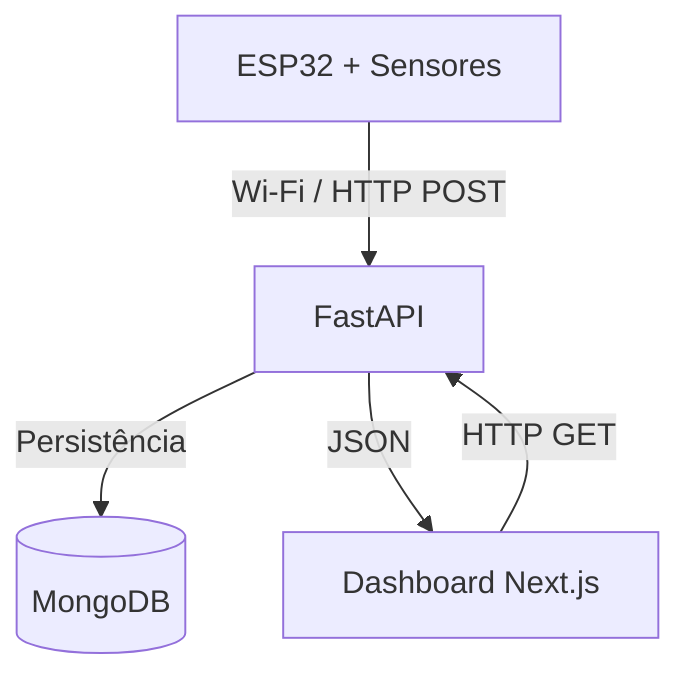

# 🌤️ Meteora

**Estação Meteorológica Inteligente com IoT**


O **Meteora** é um projeto acadêmico de Internet das Coisas (IoT) desenvolvido para monitoramento de condições meteorológicas por meio de sensores conectados a um microcontrolador ESP32.

O sistema coleta informações ambientais, transmite os dados por Wi-Fi para uma API REST, armazena as medições no MongoDB e disponibiliza os resultados em um dashboard web interativo.

O projeto integra conceitos de **sistemas embarcados, desenvolvimento full-stack, comunicação entre dispositivos e persistência de dados**, com foco em aplicações para cidades inteligentes.

---

## 📑 Sumário

- [Sobre o projeto](#-sobre-o-projeto)
- [Tecnologias utilizadas](#-tecnologias-utilizadas)
- [Arquitetura do sistema](#-arquitetura-do-sistema)
- [Sensores e medições](#-sensores-e-medições)
- [Estrutura do repositório](#-estrutura-do-repositório)
- [Instalação e execução](#-instalação-e-execução)
- [Simulação de dados](#-simulação-de-dados)
- [Integração com ESP32](#-integração-com-esp32)
- [API REST](#-api-rest)
- [Testes e validação](#-testes-e-validação)
- [Documentação](#-documentação)
- [Contexto acadêmico](#-contexto-acadêmico)

---

## 🎯 Sobre o projeto

O Meteora tem como objetivo desenvolver uma estação meteorológica capaz de coletar, processar, armazenar e apresentar informações ambientais de maneira automatizada.

### Funcionalidades

- 🌡️ Monitoramento de temperatura em graus Celsius.
- 💧 Monitoramento da umidade relativa do ar.
- 🌬️ Medição da pressão atmosférica.
- ☀️ Monitoramento da luminosidade ambiente.
- 📡 Transmissão de dados via Wi-Fi utilizando HTTP.
- 🗄️ Armazenamento das medições no MongoDB.
- 📊 Dashboard responsivo com atualização periódica.
- 📈 Exibição dos valores mínimos e máximos do dia.
- ⏱️ Identificação de medições desatualizadas.
- 🧪 Simulação de sensores para testes sem hardware físico.

> **Escopo atual:** o dashboard apresenta quatro variáveis ambientais. Monitoramento de chuva, qualidade do ar e previsões meteorológicas não fazem parte desta implementação.

## 🛠️ Tecnologias utilizadas

| Camada | Tecnologia | Responsabilidade |
|---|---|---|
| Hardware | ESP32 | Controle dos sensores e comunicação Wi-Fi |
| Firmware | Arduino / C++ | Coleta e transmissão das medições |
| Backend | Python + FastAPI | API REST e processamento de dados |
| Banco de dados | MongoDB | Persistência das medições |
| Frontend | Next.js + TypeScript | Interface web e visualização |
| Comunicação | HTTP + JSON | Integração entre os componentes |

## 🏗️ Arquitetura do sistema

O Meteora utiliza uma arquitetura dividida em três componentes principais: **dispositivo IoT, servidor backend e aplicação frontend**.



### Fluxo de funcionamento

1. O **ESP32** realiza a leitura dos sensores ambientais.
2. O firmware valida os valores e monta um objeto JSON.
3. As medições são enviadas por HTTP POST ao backend.
4. A **FastAPI** valida e armazena os dados no MongoDB.
5. O **Next.js** consulta a API para obter a última medição.
6. O dashboard apresenta as informações e os indicadores meteorológicos.

As medições são realizadas a cada **10 segundos**, enquanto o painel consulta novas informações periodicamente, com intervalo de até **30 segundos**.

Leituras com mais de **90 segundos** são sinalizadas como desatualizadas.

Para mais detalhes, consulte [Arquitetura do sistema](docs/ARQUITETURA.md).

## 🌡️ Sensores e medições

| Sensor | Variável | Unidade |
|---|---|---|
| DHT22 | Temperatura | °C |
| DHT22 | Umidade relativa | % |
| BMP280 | Pressão atmosférica | hPa |
| BH1750 | Luminosidade | lux |

### Configuração do ESP32

| Componente | Configuração |
|---|---|
| DHT22 | GPIO 4 |
| I²C SDA | GPIO 21 |
| I²C SCL | GPIO 22 |
| BMP280 | Endereço 0x76 ou 0x77 |
| Comunicação | Wi-Fi / HTTP |
| Monitor Serial | 115200 baud |

## 📁 Estrutura do repositório

```text
Meteora/
│
├── backend/                  # API REST, MongoDB e testes
├── frontend/                 # Dashboard Next.js
├── firmware/
│   └── sketch_oct31a/        # Firmware Arduino do ESP32
│
├── docs/                     # Documentação técnica
├── scripts/                  # Scripts de instalação e execução
│
├── COMECAR-AQUI.md           # Guia detalhado de configuração
└── README.md                 # Documentação principal
```

## 🚀 Instalação e execução

### Pré-requisitos

Para executar o projeto localmente no Windows, instale:

- **Python 3.12+**
- **Node.js 22.18+**
- **MongoDB Community Server**
- **Git**

Opcionalmente:

- MongoDB Compass, para visualizar os dados.
- Arduino IDE, para programar o ESP32.

### 1. Clonar o repositório

```bash
git clone <URL_DO_REPOSITORIO>
cd Meteora
```

Substitua `<URL_DO_REPOSITORIO>` pela URL real do projeto.

### 2. Preparar o ambiente

Na raiz do projeto, execute:

```powershell
.\scripts\preparar.cmd
```

O script instala as dependências necessárias e prepara os arquivos de configuração locais.

### 3. Configurar as variáveis de ambiente

**Backend — `backend/.env`**

```env
MONGODB_URI=mongodb://127.0.0.1:27017
MONGODB_DATABASE=meteora
```

**Frontend — `frontend/.env.local`**

```env
METEORA_STATION_URL=http://127.0.0.1:8000/api/station/latest
```

> Os arquivos `.env` são ignorados pelo Git. Utilize os respectivos `.env.example` como referência.

### 4. Iniciar o backend

```powershell
.\scripts\iniciar-backend.cmd
```

A API estará disponível em:

**http://localhost:8000**

Documentação interativa (Swagger):

**http://localhost:8000/docs**

### 5. Iniciar o frontend

Em outro terminal:

```powershell
.\scripts\iniciar-frontend.cmd
```

Acesse o dashboard:

**http://localhost:3000**

> Mantenha os dois terminais abertos durante a execução. O MongoDB também precisa estar em funcionamento.

## 🧪 Simulação de dados

O projeto possui um simulador que permite testar toda a integração sem conectar fisicamente o ESP32.

Com o backend e o frontend em execução:

```powershell
.\scripts\simular-dados.cmd
```

O simulador envia uma nova medição a cada **10 segundos**.

Para executar somente três medições:

```powershell
.\scripts\simular-dados.cmd --count 3 --interval 2
```

Os dados podem ser visualizados no MongoDB Compass:

```text
Database:   meteora
Collection: medicoes
```

Para remover somente as medições registradas pelo simulador:

```powershell
.\scripts\limpar-dados-simulados.cmd
```

## 🔌 Integração com ESP32

O firmware está localizado em:

```text
firmware/sketch_oct31a/sketch_oct31a.ino
```

Antes de gravá-lo na placa, configure:

- O SSID da rede Wi-Fi.
- A senha da rede Wi-Fi.
- O endereço IP do computador que executa o backend.

Exemplo de endereço da API:

```text
http://192.168.1.100:8000/api/medicoes/
```

O endereço acima é ilustrativo. Utilize o IPv4 real do computador na rede.

### Bibliotecas necessárias

Instale na Arduino IDE:

- ESP32 by Espressif Systems
- DHT sensor library by Adafruit
- Adafruit Unified Sensor
- Adafruit BMP280 Library
- Adafruit BusIO
- BH1750 by Christopher Laws

Após gravar o firmware, abra o Monitor Serial em **115200 baud** para acompanhar as leituras e as respostas HTTP.

Uma transmissão bem-sucedida retorna:

```text
Codigo HTTP: 201
Medicao salva com sucesso!
```

**Importante:** o ESP32 e o computador que executa o backend devem estar em uma rede que permita a comunicação entre ambos. A integração física depende também da montagem correta do circuito e dos sensores.

## 🌐 API REST

O backend disponibiliza endpoints para recebimento, consulta e acompanhamento das medições.

### Principais endpoints

| Método | Endpoint | Descrição |
|---|---|---|
| `GET` | `/api/health/` | Verifica o estado da API e do MongoDB |
| `POST` | `/api/medicoes/` | Registra uma nova medição |
| `GET` | `/api/medicoes/ultima/` | Retorna a última medição |
| `GET` | `/api/station/latest` | Retorna os dados formatados para o dashboard |

### Exemplo de requisição

**POST `/api/medicoes/`**

```json
{
  "temperatura": 27.50,
  "umidade": 65.20,
  "pressao": 1013.25,
  "luminosidade": 350.80
}
```

### Validação dos dados

O backend verifica:

- Presença dos quatro campos obrigatórios.
- Tipos numéricos válidos.
- Umidade entre 0% e 100%.
- Pressão e luminosidade não negativas.
- Ausência de valores nulos, infinitos ou NaN.

O timestamp é gerado automaticamente pelo backend em UTC.

**Respostas HTTP relevantes:**

| Código | Significado |
|---|---|
| `201` | Medição registrada com sucesso |
| `422` | Dados inválidos |
| `503` | Banco de dados indisponível |

Documentação completa: [Integração e dados](docs/INTEGRACAO.md).

## ✅ Testes e validação

O projeto possui testes automatizados para validar a comunicação entre firmware, backend, banco de dados e frontend.

Para executar a validação completa:

```powershell
.\scripts\validar.cmd
```

A rotina verifica:

- Testes automatizados do backend.
- Testes automatizados do frontend.
- Integração real com MongoDB.
- Validação do contrato JSON do firmware.
- Verificação de lint e TypeScript.
- Build da aplicação Next.js.
- Integração HTTP entre os componentes.

### Resultados registrados

Na revisão de **07/11/2026**, foram registrados:

| Verificação | Resultado |
|---|---|
| Testes do backend | 81 aprovados |
| Testes do frontend | 14 aprovados |
| Lint e TypeScript | Aprovados |
| Build do Next.js | Aprovado |
| Integração HTTP | Aprovada |
| Compilação do firmware ESP32 | Aprovada |

> Esses resultados comprovam as verificações de software realizadas naquela revisão. Os testes físicos de sensores, USB, Wi-Fi e montagem eletrônica precisam ser executados separadamente.

## 📚 Documentação

A documentação técnica foi separada por responsabilidade para facilitar a manutenção e a compreensão do projeto.

| Documento | Conteúdo |
|---|---|
| [Começar aqui](COMECAR-AQUI.md) | Instalação, execução e solução de problemas |
| [Funcionamento](docs/FUNCIONAMENTO.md) | Fluxo completo dos dados |
| [Arquitetura](docs/ARQUITETURA.md) | Componentes e comunicação |
| [Integração](docs/INTEGRACAO.md) | Contratos, validação e persistência |
| [Índice da documentação](docs/README.md) | Organização dos documentos |
| [Backend](backend/README.md) | Configuração e funcionamento da API |
| [Frontend](frontend/README.md) | Configuração e funcionamento do dashboard |

## 🎓 Contexto acadêmico

O Meteora é desenvolvido como projeto integrador da disciplina **Projeto e Desenvolvimento II**, do curso de **Ciência da Computação da Universidade Paulista (UNIP)**.

O trabalho tem como propósito aplicar conhecimentos adquiridos ao longo do semestre, integrando programação, eletrônica digital, sistemas embarcados, banco de dados e desenvolvimento web.

A proposta está relacionada ao conceito de **cidades inteligentes**, utilizando tecnologias de IoT para coleta e disponibilização de informações ambientais.

---

**Meteora — Tecnologia, dados e monitoramento ambiental.**
