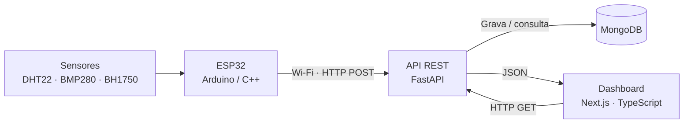

<div align="center">
<h1>🌤️ Meteora</h1>
  <p><strong>Uma estação meteorológica inteligente, do sensor ao dashboard.</strong></p>

  <p>
    <a href="https://github.com/UNIP-Projetos-da-Faculdade/Meteora/releases/tag/v1.0.0"></a>
    <a href="LICENSE"></a>
    
  </p>

  <p>
    
    
    
    
    
    
  </p>

  <p>
    <a href="#-vis%C3%A3o-geral">Visão geral</a> ·
    <a href="#-arquitetura">Arquitetura</a> ·
    <a href="#-executando-localmente">Instalação</a> ·
    <a href="#-testes-e-valida%C3%A7%C3%A3o">Testes</a> ·
    <a href="COMECAR-AQUI.md">Guia completo</a> ·
    <a href="https://github.com/UNIP-Projetos-da-Faculdade/Meteora/releases/tag/v1.0.0">Release v1.0.0</a>
  </p>
</div>

---

## 🎯 Visão geral

O **Meteora** é uma estação meteorológica inteligente desenvolvida como projeto acadêmico de **Internet das Coisas (IoT)**. Sensores conectados a um **ESP32** coletam informações ambientais, que são transmitidas por Wi-Fi para uma **API REST em FastAPI**, armazenadas no **MongoDB** e apresentadas em um **dashboard responsivo desenvolvido com Next.js e TypeScript**.

A solução integra sistemas embarcados, comunicação entre dispositivos, desenvolvimento web full-stack e persistência de dados, em um cenário de monitoramento ambiental relacionado ao conceito de **cidades inteligentes**.

### ✨ O que o sistema faz

| Recurso | Descrição |
| --- | --- |
| 🌡️ **Temperatura e umidade** | Monitora as condições do ambiente com o sensor DHT22. |
| 🌬️ **Pressão atmosférica** | Apresenta medições do BMP280 em hPa. |
| ☀️ **Luminosidade** | Exibe leituras do BH1750 em lux. |
| 📡 **Comunicação IoT** | Envia medições via Wi-Fi e HTTP para o backend. |
| 📊 **Dashboard web** | Mostra as leituras com atualização periódica e layout responsivo. |
| 📈 **Indicadores diários** | Apresenta valores mínimos e máximos do dia. |
| ⏱️ **Leitura desatualizada** | Sinaliza a ausência de novas medições após 90 segundos. |
| 🧪 **Modo de simulação** | Permite testar API, banco de dados e dashboard sem o ESP32 físico. |

> **Escopo da v1.0.0:** o dashboard cobre temperatura, umidade, pressão atmosférica e luminosidade. Previsão do tempo, chuva e qualidade do ar **não** fazem parte desta versão.

<!-- CAPTURAS REAIS DO PROJETO
Quando houver screenshots reais, salve as imagens em docs/assets/ e substitua este comentário por:

## 🖥️ Demonstração

<p align="center">
  
</p>

Se houver foto autorizada da montagem física, adicione-a aqui com uma legenda clara.
Não utilize mockups como se fossem capturas reais do sistema.
-->

## 🏗️ Arquitetura



**Fluxo de dados:** o ESP32 lê os sensores e envia medições ao backend a cada **10 segundos**. A API valida e persiste os dados no MongoDB. O dashboard consulta as informações periodicamente, em intervalos de até **30 segundos**.

| Camada | Tecnologias | Papel |
| --- | --- | --- |
| Dispositivo IoT | ESP32, Arduino/C++ | Leitura dos sensores e envio por HTTP |
| Backend | Python 3.12+, FastAPI | Validação, registro e consulta das medições |
| Banco de dados | MongoDB | Armazenamento das medições |
| Frontend | Next.js, TypeScript | Interface responsiva e indicadores |
| Comunicação | Wi-Fi, HTTP, JSON | Integração entre os componentes |

📚 **Detalhes técnicos:** [Arquitetura](docs/ARQUITETURA.md) · [Funcionamento](docs/FUNCIONAMENTO.md) · [Integração e dados](docs/INTEGRACAO.md)

## 🔌 Sensores e hardware

| Sensor / componente | Medição ou configuração |
| --- | --- |
| **DHT22** | Temperatura (°C) e umidade relativa (%) |
| **BMP280** | Pressão atmosférica (hPa) |
| **BH1750** | Luminosidade (lux) |
| **DHT22 → ESP32** | GPIO 4 |
| **I²C SDA / SCL** | GPIO 21 / GPIO 22 |
| **BMP280 (I²C)** | Endereço `0x76` ou `0x77` |
| **Monitor serial** | 115200 baud |

O firmware está em [`firmware/sketch_oct31a/sketch_oct31a.ino`](firmware/sketch_oct31a/sketch_oct31a.ino). Para utilizar a placa, configure o **SSID**, a **senha do Wi-Fi** e o **IP do computador que executa a API**. A placa e o servidor precisam estar em uma rede que permita a comunicação entre eles.

Bibliotecas utilizadas: **ESP32 by Espressif Systems**, **DHT sensor library**, **Adafruit Unified Sensor**, **Adafruit BMP280 Library**, **Adafruit BusIO** e **BH1750 by Christopher Laws**.

> A compilação do firmware foi validada; a montagem eletrônica e o funcionamento dos sensores físicos dependem de testes próprios. Não confunda essa validação de software com um teste completo em hardware.

## 🚀 Executando localmente

O fluxo automatizado documentado abaixo é voltado ao **Windows**. Para orientações passo a passo e solução de problemas, consulte [**COMECAR-AQUI.md**](COMECAR-AQUI.md).

### Pré-requisitos

- **Python 3.12+**
- **Node.js 22.18+**
- **MongoDB Community Server** em execução
- **Git**
- **Arduino IDE** (apenas para gravar o firmware no ESP32)

### 1. Clone o projeto

```bash
git clone https://github.com/UNIP-Projetos-da-Faculdade/Meteora.git
cd Meteora
```

### 2. Prepare o ambiente

No terminal do Windows, na raiz do repositório:

```powershell
.\scripts\preparar.cmd
```

O script instala as dependências e prepara os arquivos locais de configuração. Ajuste as variáveis a seguir, conforme necessário:

**`backend/.env`**

```dotenv
MONGODB_URI=mongodb://127.0.0.1:27017
MONGODB_DATABASE=meteora
```

**`frontend/.env.local`**

```dotenv
METEORA_STATION_URL=http://127.0.0.1:8000/api/station/latest
```

> Use os arquivos `.env.example` como referência. Não publique senhas ou credenciais nos arquivos versionados.

### 3. Inicie os serviços

Em **terminais separados**, execute:

```powershell
# Terminal 1 — API
.\scripts\iniciar-backend.cmd
```

```powershell
# Terminal 2 — dashboard
.\scripts\iniciar-frontend.cmd
```

| Serviço | Endereço local |
| --- | --- |
| Dashboard | <http://localhost:3000> |
| API REST | <http://localhost:8000> |
| Swagger / OpenAPI | <http://localhost:8000/docs> |
| Health check | <http://localhost:8000/api/health/> |

**O MongoDB precisa estar em execução.** Os terminais do backend e do frontend devem permanecer abertos.

### 4. Simule leituras (sem ESP32)

Com os serviços em execução:

```powershell
.\scripts\simular-dados.cmd
```

O simulador envia dados fictícios a cada **10 segundos**, utilizando a mesma rota HTTP do dispositivo. Para realizar apenas três envios:

```powershell
.\scripts\simular-dados.cmd --count 3 --interval 2
```

Para remover somente as medições registradas pelo simulador:

```powershell
.\scripts\limpar-dados-simulados.cmd
```

Os registros são armazenados no MongoDB, no banco `meteora` e na coleção `medicoes`.

## 🌐 API REST

| Método | Endpoint | Finalidade |
| --- | --- | --- |
| `GET` | `/api/health/` | Verificar o estado da API e do MongoDB |
| `POST` | `/api/medicoes/` | Registrar uma nova medição |
| `GET` | `/api/medicoes/ultima/` | Consultar a medição mais recente |
| `GET` | `/api/station/latest` | Obter a resposta consumida pelo dashboard |

Exemplo de payload para `POST /api/medicoes/`:

```json
{
  "temperatura": 27.5,
  "umidade": 65.2,
  "pressao": 1013.25,
  "luminosidade": 350.8
}
```

A API exige os quatro campos numéricos, rejeita valores nulos, `NaN` e infinitos e gera o timestamp em **UTC**. Ela preserva códigos numéricos de falha enviados pelos sensores; no dashboard, valores fora das faixas esperadas são apresentados como **“Leitura indisponível”**, sem eliminar os dados brutos do histórico.

**Respostas comuns:** `201` (registro realizado), `422` (dados inválidos) e `503` (banco indisponível).

Mais detalhes: [docs/INTEGRACAO.md](docs/INTEGRACAO.md).

## ✅ Testes e validação

Para executar a rotina de validação disponível no Windows:

```powershell
.\scripts\validar.cmd
```

A rotina abrange testes de backend e frontend, integração com MongoDB, contrato JSON do firmware, lint, TypeScript, build do Next.js e comunicação HTTP.

**Resultados registrados em 07/11/2026:**

| Verificação | Resultado naquela revisão |
| --- | --- |
| Testes automatizados do backend | **83 aprovados** |
| Testes automatizados do frontend | **16 aprovados** |
| Lint e TypeScript | Aprovados |
| Build do Next.js | Aprovado |
| Integração HTTP | Aprovada |
| Compilação do firmware ESP32 | Aprovada |

> Esses números registram a revisão indicada, **não um status de CI em tempo real**. Testes físicos de sensores, montagem, USB e comunicação Wi-Fi devem ser realizados separadamente.

## 📁 Organização do repositório

```text
Meteora/
├── backend/                  # API, persistência e testes
├── frontend/                 # Dashboard em Next.js
├── firmware/                 # Sketch Arduino do ESP32
├── docs/                     # Documentação técnica e recursos do README
│   └── assets/               # Banner e futuras capturas reais
├── scripts/                  # Preparação, execução, simulação e validação
├── COMECAR-AQUI.md           # Guia completo de execução
├── LICENSE                   # Licença MIT
└── README.md                 # Visão geral do projeto
```

## 📚 Documentação

| Documento | Conteúdo |
| --- | --- |
| [Começar aqui](COMECAR-AQUI.md) | Instalação, execução e resolução de problemas |
| [Funcionamento](docs/FUNCIONAMENTO.md) | Caminho percorrido pelos dados |
| [Arquitetura](docs/ARQUITETURA.md) | Estrutura e comunicação entre componentes |
| [Integração](docs/INTEGRACAO.md) | API, validações e persistência |
| [Índice da documentação](docs/README.md) | Navegação pelos documentos técnicos |
| [Backend](backend/README.md) | Configuração e funcionamento da API |
| [Frontend](frontend/README.md) | Estrutura e execução da interface |

## 🎓 Contexto acadêmico e créditos

O Meteora foi desenvolvido em equipe para a disciplina **Projeto e Desenvolvimento II**, do curso de **Ciência da Computação da Universidade Paulista (UNIP)**, como aplicação prática de conhecimentos em sistemas embarcados, eletrônica, APIs, bancos de dados e desenvolvimento web.

As contribuições individuais podem ser consultadas no [histórico de commits](https://github.com/UNIP-Projetos-da-Faculdade/Meteora/commits/main) e na [página de contribuidores](https://github.com/UNIP-Projetos-da-Faculdade/Meteora/graphs/contributors).

<!-- Quando a equipe confirmar nomes, perfis e responsabilidades, inclua uma tabela
     'Integrante | Responsabilidade | GitHub' aqui. Não atribua funções por suposição. -->

## 📦 Versão e licença

A versão acadêmica final está publicada como [**Meteora v1.0.0**](https://github.com/UNIP-Projetos-da-Faculdade/Meteora/releases/tag/v1.0.0).

O código está disponível sob a **licença MIT**. Consulte o arquivo [LICENSE](LICENSE) para os termos completos.

---

<div align="center">
  <sub><strong>Meteora</strong> — Tecnologia, dados e monitoramento ambiental.</sub>
</div>
