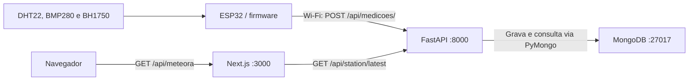

# Arquitetura do Meteora

## Visão geral

O projeto tem quatro partes: aquisição no ESP32, API FastAPI, armazenamento
MongoDB e painel Next.js. O firmware produz as medições, o backend organiza
o acesso aos dados e o frontend apresenta a leitura da estação.

As setas representam as leituras dos sensores e as requisições entre os
componentes. As respostas retornam pelo caminho das respectivas requisições.

## Firmware: aquisição e transmissão

O arquivo [sketch_oct31a.ino](../firmware/sketch_oct31a/sketch_oct31a.ino)
inicializa os sensores, conecta a placa ao Wi-Fi e executa o ciclo de leitura.
Ele monta o JSON dos quatro campos e faz o POST HTTP na API.

A placa não acessa o MongoDB nem o frontend diretamente. Sua interface com
o restante do projeto é o endpoint de ingestão. O endereço da API e os dados
da rede Wi-Fi ficam nos campos de configuração já existentes no firmware.

## Backend: validação, persistência e consultas

O backend usa Python, FastAPI, Uvicorn, Pydantic e PyMongo. Sua organização é:

| Arquivo | Responsabilidade |
| --- | --- |
| [main.py](../backend/app/main.py) | Cria a aplicação, gerencia a conexão MongoDB e configura CORS e erros HTTP |
| [config.py](../backend/app/config.py) | Carrega as configurações do ambiente e do `.env` |
| [database.py](../backend/app/database.py) | Disponibiliza a coleção e cria o índice de consulta |
| [models.py](../backend/app/models.py) | Define os campos, unidades e regras de validação |
| [routers.py](../backend/app/routers.py) | Declara os endpoints HTTP |
| [services.py](../backend/app/services.py) | Insere medições, consulta o histórico e calcula os extremos observados |

As operações com PyMongo são síncronas e executadas pelo FastAPI em threads.
O cliente MongoDB é criado na inicialização da aplicação, compartilhado durante
a execução e fechado no encerramento.

A API mantém o contrato do firmware em português e oferece uma resposta
adaptada ao painel em inglês. Essa conversão ocorre no backend; as unidades
permanecem as mesmas.

## MongoDB: histórico das medições

O MongoDB armazena os documentos na coleção `medicoes`. Cada documento contém
as quatro grandezas medidas, o horário de registro em UTC e seu identificador.

Um índice composto em `timestamp` e `_id`, ambos em ordem decrescente, favorece
a busca das medições recentes. O identificador também desempata documentos
registrados no mesmo milissegundo.

A conexão usa `MONGODB_URI`, e o nome do banco usa `MONGODB_DATABASE`. Essas
configurações são fornecidas por variáveis de ambiente ou `backend/.env`.
O ESP32 não precisa conhecer a URI do banco.

## Frontend: consulta e interface

O frontend usa Next.js, React, TypeScript e Tailwind CSS. O caminho da leitura é:

1. [useDashboard.ts](../frontend/src/hooks/useDashboard.ts) consulta `/api/meteora`
   no navegador e controla atualização, carregamento e preservação da última leitura.
2. [route.ts](../frontend/src/app/api/meteora/route.ts) executa no servidor Next.js
   e solicita a leitura ao backend.
3. [backend.ts](../frontend/src/lib/backend.ts) faz a chamada HTTP com timeout e
   tratamento de falhas.
4. [contracts.ts](../frontend/src/lib/contracts.ts) valida o JSON recebido.
5. [Dashboard.tsx](../frontend/src/components/Dashboard.tsx) reúne a temperatura
   principal, estado da conexão e os cards das quatro medições.

A URL do backend fica no servidor Next.js, em `METEORA_STATION_URL`. O navegador
consulta a rota do próprio site e não precisa conhecer o endereço do MongoDB
ou fazer consultas diretas ao banco.

## Rede e execução

| Componente | Porta usual | Quem o acessa |
| --- | --- | --- |
| FastAPI | 8000 | ESP32 e servidor Next.js |
| MongoDB | 27017 | Backend FastAPI |
| Next.js | 3000 | Navegador do usuário |

Backend e frontend podem executar no computador próximo à estação. O MongoDB
pode permanecer acessível apenas localmente nesse computador. Para o ESP32,
a URL da API deve usar o IP de rede do computador, pois `localhost` na placa
não aponta para esse servidor.

Os comandos Windows estão em [scripts/](../scripts). A instalação e a sequência
de inicialização estão no [README da raiz](../README.md).

O escopo atual é acompanhar as grandezas disponíveis no firmware. Previsão
meteorológica, precipitação acumulada e medição de qualidade do ar não fazem
parte dos dados apresentados pelo painel.
